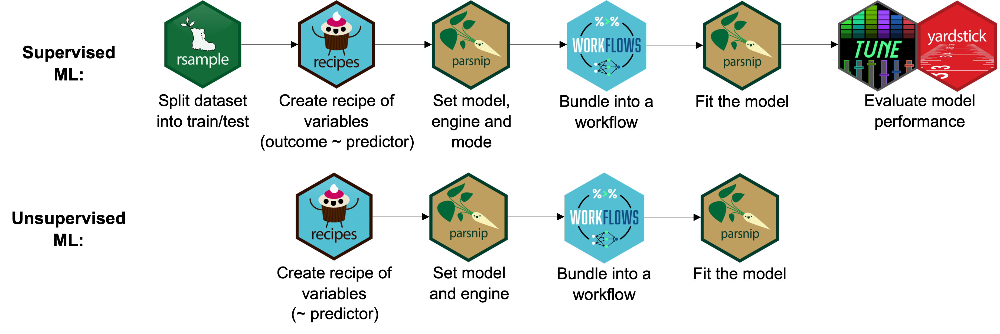
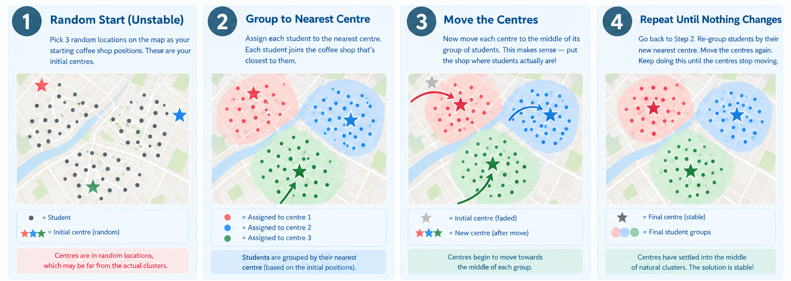

---
filters:
 - naquiz
format:
  html:
    toc: true
    toc-location: left
    toc-title: "In this session:"
editor: 
  markdown: 
    wrap: 72
---

# Tutorial 11: Unsupervised Machine Learning in R {#sec-tute11}

Workshop 8 focussed on how we develop **supervised** machine learning
models in R using the `tidymodels` package (create a recipe, specify
a model, bundle a workflow, and fit) which we can use when our data 
has labels: where we know what each grouping should be.

But what happens when we don't know this?

This is when we use **unsupervised** machine learning, which aims to 
discover patterns or structures in the data **without prior knowledge 
of the groupings**. We have already come across Multidimensional 
Scaling (MDS) plots [in workshop 7](@sec-workshop07), and you may have 
encountered Principal Components Analysis (PCA), k-means clustering or 
hierarchical clustering in your research so far.

In this tutorial, we will reuse the same workflow concepts you learned
in Workshop 8 (recipe → model → workflow → fit), but apply them to an
unsupervised task: k-means clustering with the `tidyclust` package.

::: {.callout-tip title="Learning Objectives"}
This workshop directly builds on [Workshop 8](@sec-workshop08). At the
end of this session, learners should be able to:

1. Understand the difference between 
    [supervised](wk11_fr.qmd#supervised-ml){.quarto-xref} 
    and [unsupervised](wk11_fr.qmd#unsupervised-ml){.quarto-xref} 
    machine learning and explore their applications in biomedical 
    research.
2. Construct a complete `tidymodels` workflow: create a
   [recipe](wk11_fr.qmd#recipe){.quarto-xref}, specify a model,
   bundle a [workflow](wk11_fr.qmd#silhouette-score){.quarto-xref}, 
   to train a k-means clustering algorithm. 
3.  Fit a k-means model, inspect centroids, and assign cluster 
    predictions to observations
4.  Evaluate clusters against known biological groupings
:::

The key difference between supervised and unsupervised machine learning
in our current `tidymodels` workflow is shown in the figure below: 



For **supervised ML**, the pipeline we followed included splitting our dataset
into a training and testing dataset, our recipe contained both an outcome
and predictor variable/s, we set the model (e.g., random forest), engine 
(R package) and mode (classification or regression), bundled the workflow, 
fit the model and then evaluated model performance. 

For **unsupervised ML**, the pipeline differs in that we will not be 
splitting our dataset into train/test sets, our recipe does not need an 
outcome predictor variable (as we do NOT know the outcome), we set the model
(e.g., k-means clustering), engine (R package) and do not need to set a mode, 
bundle the workflow and fit the model. 

We cannot explicitly evaluate model performance in the same way because 
there are no labels to measure against. Instead there are other, relative, 
measures we can employ to test how well our model performs. One such measure 
is the [silhouette score](#sec-silhouette){.quarto-xref}, which measures 
cluster *geometry* (how compact and well-separated the clusters are) rather
than correctness. It is as a way to compare results, like different values of 
*k*, not whether the clustering is "correct". This still requires biological
prior knowledge. You can read more about the silhouette scores and plots in
the [extension section](@sec-silhouette) below.

## Setup {#sec-t11-setup}
```{r}
#| label: internal-setup
#| echo: false 
#| message: false
#| warning: false
library(tidyverse)
library(tidymodels)
library(tidyclust)
library(cluster)
library(factoextra)
library(patchwork)
theme_set(theme_bw())
```

```{r}
#| label: setup-t11
#| output: false
#| message: false
#| eval: false 

# Install packages if not already installed
install.packages(c(
  "tidyclust",
  "cluster",
  "factoextra"
))

library(tidyverse) # Data manipulation and visualisation
library(tidymodels) # Modelling framework
library(tidyclust) # Clustering extension for tidymodels
library(cluster) # Silhouette computation
library(factoextra) # Silhouette visualisation
library(patchwork) # Combining plots side by side
```



Save into your `data/` directory.

```{r}
noisy_dosage <- read_csv(
  "data/noisy_mousezempic_dosage_data.csv"
)
```

Or you can run the code below to download the dataset from a URL: 

```{r}
#| exec: false
#| eval: false 
noisy_dosage <- read_csv(
  "https://raw.githubusercontent.com/WEHI-Education/BIOL90042_R_Course/refs/heads/main/data/noisy_mousezempic_dosage_data.csv"
)
```

## K-Means Clustering with tidyclust {#sec-t11-kmeans}

Using our `noisy_dosage` dataset, our aim is to apply an unsupervised 
machine learning model to cluster mouse strains based on physiological
and dosage features only.

For this tutorial, we will be training a k-means clustering model.

::: {.callout-note title="What is a k-means clustering algorithm?"}

Let's work through an example used in the lecture. 

You're opening three new coffee shops in a city and want to know where 
the best place is for students to gather. You have data showing where 
100 students like to hang out. How do you decide the best locations? 

Because you're a coding expert, you decide to use a k-means clustering
algorithm to solve this by finding three natural "meeting spots" in 
your data.



1. Pick three (k = 3) random locations on the map as your starting coffee 
  spot positions. These are your **initial centres**. 
2. Assign each student to the nearest centre based on their location to
  the initial centres. 
3. Move the centre to the middle of each group of students. This creates
  a new centre which is more representative of where students are. 
4. Repeat from step 2 until nothing changes. When the centres are stable, 
  it means that you have found the natural meeting spot you're after! 

K-means clustering algorithms are iterative and repeatedly ask: 
1. Who belongs to each group? 
2. Where should each group's centre be? 
3. Repeat until stable: this leads us to the best possible solution

*Note*: Alternatively you could work through this process by asking:
how many coffee shops would fit for this cohort of 100 students? This
would require the use of tuning the *k* parameter to see how many
coffee shops would best suit this dataset. You can read more on how 
to do this in our [extension sections](#extension) below.
:::

### Prepare the Data {#sec-t11-wrangling}

In this tutorial we apply **unsupervised learning** to the
`noisy_mousezempic_dosage_data` dataset, but this time pretending we 
do *not* know the strain labels.

The `noisy_mousezempic_dosage_data` dataset contains measurements for 
**344 mice** across three strains (CD1, BALBc, and Black6) housed across 
three cages.

::: {.callout-note title="Biological Prior: How Many Clusters Should We Expect?"}
The best results will be obtained with prior knowledge of the optimal
cluster number (`k`). 

For the mousezempic dataset, we have a clear **biological prior**: there
are **3 known strains**: CD1, BALBc, and Black6. This gives us a strong
reason to expect `k = 3` to be the most biologically meaningful
solution, so we set `k = 3` directly in our model. An optional
**extension** later in this session uses silhouette analysis, a
data-driven approach, to confirm or challenge this prior.
:::

We are going to explicitly keep only the numeric physiological features
of our dataset and remove any missing values. Strain labels are
deliberately **excluded** as we are aiming to use **unsupervised
learning**: we do not want to inform the algorithm about strain
identity.

```{r}
#| label: prepare-clustering-data

dosage_clust <- noisy_dosage %>%
  # remove all NAs in our dataset
  drop_na() %>%
  # keep only the numeric physiological features of our dataset
  select(initial_weight_g, tail_length_mm, drug_dose_g, weight_lost_g)

# view our dataset features (dplyr equivalent of `str()`)
glimpse(dosage_clust)
```

### Explore the Data {#sec-t11-explore}

Let's visualise the raw data by plotting initial weight
(`initial_weight_g`) against drug dose (`drug_dose_g`).

```{r}
#| label: explore-data-2

dosage_clust %>%
  ggplot(aes(x = initial_weight_g, y = drug_dose_g)) +
  geom_point(size = 2.5, alpha = 0.8) +
  labs(
    title = "Mouse Initial Weight vs Drug Dose",
    x = "Initial Weight (g)",
    y = "Drug Dose (g)"
  )
```

Here we can see varying initial weights and drug doses across the *n* =
333 mice remaining in our dataset — but the points form essentially
**one large grouping**, with no obvious subgroups.

::: {.callout-note title="Activity: Can You Find the Hidden Groups?"}
Our biological prior tells us there are **3 strains** in this data, yet
the plot above shows only one cloud of points. Our dataset has four
numeric variables (`initial_weight_g`, `tail_length_mm`,
`drug_dose_g`, and `weight_lost_g`), so maybe a different pair of
variables will reveal the groupings.

Modify the plotting code below to explore **different pairs of variables** 
(there are 6 possible pairs in total). For each plot, ask yourself: can 
I see any distinct clusters?

```{r}
#| label: explore-pairs
#| eval: false

# Try swapping in different variables, e.g. tail_length_mm vs weight_lost_g
dosage_clust %>%
  ggplot(aes(x = initial_weight_g, y = drug_dose_g)) +
  geom_point(size = 2.5, alpha = 0.8)
```

:::

::::::::: {.callout-important title="Test Your Knowledge"}
:::::::: question
1\. After plotting different pairs of variables, how many clear
groupings could you identify in **any** of the two-dimensional plots?

::::::: choices
::: {.choice .correct-choice}
None: every pair looks like one big cloud of points
:::

::: choice
Two: initial weight vs drug dose clearly shows two groups
:::

::: choice
Three: the three strains are visible in at least one pair of variables
:::

::: choice
Four: each cage forms its own visible cluster
:::

:::::::
::::::::

<details>

<summary>Solutions</summary>

<p>

1. Correct! No pair of variables shows clear, separated groups. Every
   two-dimensional plot looks like one large cloud. This illustrates a
   key limitation of exploring data in **two dimensions**. The groupings 
   may only become apparent when **all four variables are considered together**, in the full four-dimensional feature space. This is exactly 
   where unsupervised ML techniques can help. 
2. Incorrect: initial weight vs drug dose forms a single cloud.
3. Incorrect: the strains are not clearly separable in any single pair
   of variables; that is precisely why we need clustering.
4. Incorrect: no pair of variables reveals distinct cage or strain
   clusters.

</p>

</details>
:::::::::

### Define a Preprocessing Recipe {#sec-kmeans-recipe}

Recall from Workshop 8 that a
**[recipe](wk11_fr.qmd#recipe){.quarto-xref}** specifies the variables
to include in the model and the preprocessing steps to apply, expressed
as a statistical formula: `outcome variable ~ predictor variables` .

There is one key difference here from the supervised case: in
**unsupervised learning**, we have **no outcome variable** because we do 
not know the class labels. Our recipe formula is therefore `~ .` (no
outcome, all predictors).

As we saw in our figure above, the x- and y-axes are on markedly
different scales. As in Workshop 8, we **normalise** the data to place
all variables on a common scale where the mean = 0 and standard
deviation = 1.

::: {.callout-note title="Why is normalisation essential for k-means?"}
K-means clustering assigns observations to clusters based on **Euclidean 
distance**, the straight-line distance between points in feature space.
If one variable is measured in grams (thousands) and another in
millimetres (tens), the gram variable will dominate the distance
calculation, regardless of its biological relevance. Normalisation
removes this scale bias.
:::

Just like in [workshop 8](workshop_8.qmd#define-a-preprocessing-recipe), 
we first initialise our k-means clustering algorithm by defining our 
recipe and add any pre-processing steps. Here, we are going to 
normalise all of our numeric predictors just like in our workshop. *Note*
because we removed all categorical predictor variables, we do not need
to apply the `step_dummy()` function to categorical (nominal) variables.

```{r}
#| label: clustering-recipe
#| 
kmeans_recipe <- recipe(~., data = dosage_clust) %>%
  step_normalize(all_numeric_predictors())

summary(kmeans_recipe)
```

### Specify the K-Means Model {#sec-kmeans-specify}

Now that we have our recipe, we can specify our model using the 
`k_means()` function from `tidyclust` . We set our engine 
(`set_engine()`) to `"stats"` , which uses base R's built-in 
`kmeans()` function. We **do not** need to set a mode here because
we are doing unsupervised ML (whereas for supervised ML, we 
need to specify `"regression"` or `"classification"`).

Setting `num_clusters = 3` fixes the number of clusters up front, using
our **biological prior** of three known strains. (An optional extension
below shows how to choose *k* from the data instead, using silhouette
tuning.)

Setting `nstart = 25` runs the algorithm 25 times with different random
centroid initialisations and keeps the best result. This is important
because k-means is sensitive to where the centroids start.

::: {.callout-warning title="What is a centroid? And why does it need to be initialised?"}

A **centroid** is the point at the center of a cluster: you can think
of it as the cluster's "address".

K-means has to start somewhere, so it begins by placing the centroids at
**random** positions. It then gradually moves them to better positions,
step by step, until they settle. The catch is that where they start
affects where they end up: an unlucky random start can lead to a poor
final clustering, even with the same data.

To avoid relying on luck, we simply run the algorithm many times from
different random starts and keep the best result. That is exactly what
`nstart = 25` does below: it runs k-means 25 times and keeps the run
where the points are tightest around their centroids.
:::

```{r}
#| label: kmeans-spec

kmeans_spec <- k_means(num_clusters = 3) %>% # our model
  set_engine("stats", nstart = 25) # our engine

kmeans_spec
```

### Bundle into a Workflow {#sec-kmeans-workflow}

Just as in Workshop 8, we combine the recipe and model into a single
**[workflow](wk11_fr.qmd#workflow){.quarto-xref}** object, so that the
same preprocessing steps are always applied consistently whenever the
model is fitted or used to predict.

```{r}
#| label: clustering-workflow

kmeans_workflow <- workflow() %>%
  add_recipe(kmeans_recipe) %>%
  add_model(kmeans_spec)

kmeans_workflow
```

:::::::::: {#extension .callout-tip title="Extension: Choosing k with a Data-Driven Approach (Silhouette Tuning)" collapse="true"}

In the main workflow we set `num_clusters = 3` directly from our
biological prior. But what if we did *not* know how many groups to
expect? The **silhouette score** offers a data-driven way to choose *k*:
it measures how well each observation fits its assigned cluster relative
to neighbouring clusters. This extension shows two routes — a quick
one-liner, and the full `tidymodels` tuning approach.

#### A quick route: `fviz_nbclust()`

The silhouette score is computed from **pairwise Euclidean distances**
between mice — the same distances k-means uses. Just as in our recipe,
those distances must be computed on **normalised** data, otherwise the
variable with the largest units dominates. Rather than scaling by hand,
we extract exactly the normalised data the model saw from our fitted
recipe using `prep()` + `bake()`:

```{r}
#| label: extension-fviz-nbclust

# Extract the scaled data from the fitted recipe
scaled_data <- kmeans_recipe %>%
  prep() %>%
  bake(new_data = dosage_clust)

# Try a range of k values and plot the average silhouette for each
fviz_nbclust(scaled_data, kmeans, method = "silhouette")
```

#### The full route: tuning over values of k with `tune_cluster()` {#sec-kmeans-tuning}

The full route uses the same `tune_*()` machinery you saw for supervised
models in Workshop 8. To use it, we would change our model specification
to `k_means(num_clusters = tune())`. Here we evaluate *k* from 2 to 8
clusters. We cap at 8 as there is no biological reason to expect more than 
a small number of morphologically distinct mouse groups. Recall that our 
biological prior suggests *k* = 3 (three strains).

```{r}
#| label: clustering-grid

# A tuning version of our specification and workflow:
# num_clusters is now a placeholder to be tuned, not fixed at 3
kmeans_spec_tune <- k_means(num_clusters = tune()) %>%
  set_engine("stats", nstart = 25)

kmeans_workflow_tune <- workflow() %>%
  add_recipe(kmeans_recipe) %>%
  add_model(kmeans_spec_tune)

kmeans_grid <- tibble(num_clusters = 2:8)
```

We create 10 **bootstrap resamples** of the data to obtain more stable
silhouette estimates. We then tune the workflow across all values of
*k*, collecting the `silhouette_avg` metric: a measure of how well each
observation fits its assigned cluster relative to neighbouring clusters.

```{r}
#| label: tune-clusters

# Insert a seed because this step involves randomness!
set.seed(123)

kmeans_resamples <- bootstraps(dosage_clust, times = 10)

kmeans_tuning <- tune_cluster(
  kmeans_workflow_tune,
  resamples = kmeans_resamples,
  grid = kmeans_grid,
  metrics = cluster_metric_set(silhouette_avg)
)

collect_metrics(kmeans_tuning)
```

We now have an averaged silhouette estimate for each value of *k*, where
values range from -1 (misclassified) to +1 (well-clustered). A score >
0.5 generally indicates reasonable cluster structure.

#### Silhouette Plot Across k {#sec-silhouette}

We can visualise the mean silhouette width for each value of *k* using
`ggplot2` . The red dashed line marks our biological prior of *k* = 3,
allowing us to assess whether the data-driven optimum agrees with our
prior knowledge.

```{r}
#| label: silhouette-plot

kmeans_tuning %>%
  collect_metrics() %>%
  filter(.metric == "silhouette_avg") %>%
  ggplot(aes(x = num_clusters, y = mean)) +
  geom_line(colour = "steelblue", linewidth = 1) +
  geom_point(colour = "steelblue", size = 3) +
  # extra things we can add to our silhouette plot
  geom_errorbar(
    aes(ymin = mean - std_err, ymax = mean + std_err),
    width = 0.2,
    alpha = 0.6
  ) +
  geom_vline(
    xintercept = 3,
    linetype = "dashed",
    colour = "firebrick",
    linewidth = 0.8
  ) +
  scale_x_continuous(breaks = 2:8) +
  labs(
    title = "Average Silhouette Width by Number of Clusters",
    x = "Number of Clusters (k)",
    y = "Mean Silhouette Width"
  )
```

::: {.callout-tip title="Interpreting the silhouette plot"}
The [silhouette score](wk11_fr.qmd#silhouette-score){.quarto-xref}
ranges from **-1** (poor, misassigned points) to **+1** (optimal,
well-separated clusters). In this analysis, the silhouette is actually
**maximised at k = 2**, not at our biological prior of k = 3. This is a
common and instructive result: the silhouette criterion rewards
well-separated clusters, so when two groups lie close together in
feature space it prefers to merge them. Here, k = 2 largely lumps BALBc
and CD1 mice into a single cluster while separating Black6 mice. That
is a worse *biological* solution even though it scores better *geometrically*.

This is why the silhouette score should inform, not dictate, the choice
of `k`. With a strong biological prior of three known strains, we
select **k = 3**. Its silhouette remains positive (~0.2),
indicating that the three-cluster solution still captures real
structure: just with two strains that partially overlap. 
:::

::::::::: {.callout-important title="Test Your Knowledge"}
:::::::: question
2\. What does a silhouette score of 0 indicate for an observation?

::::::: choices
::: choice
The observation is perfectly assigned to its cluster
:::

::: {.choice .correct-choice}
The observation lies on the boundary between two clusters
:::

::: choice
The observation has been misassigned to the wrong cluster
:::

::: choice
The observation is an outlier
:::

:::::::
::::::::

<details>

<summary>Solutions</summary>

<p>

1. A score of +1 indicates perfect assignment. A score of 0 means
    something different.
2. Correct! A silhouette score of 0 means the observation is equally
    close to its own cluster and the nearest neighbouring cluster — it
    sits right on the decision boundary.
3.  Misassignment is indicated by a negative silhouette score, not zero.
4. Outliers may have low silhouette scores, but a score of 0
    specifically indicates a boundary observation.

</p>

</details>
:::::::::

#### Using the Best k from Tuning {#sec-prior}

But what if we wanted to use the **data-driven** optimum instead (i.e.,
the silhouette maximum of *k* = 2)? We can use this code to do just that! 

```{r}
#| label: select-best-k

# Pull out the value of k with the highest mean silhouette (here, k = 2)
best_k_datadriven <- select_best(kmeans_tuning, metric = "silhouette_avg")

# Insert that value into the tuning workflow, replacing tune()
final_kmeans_workflow <- finalize_workflow_tidyclust(
  kmeans_workflow_tune,
  best_k_datadriven
)

final_kmeans_workflow
```

We could then fit this workflow with
`fit(final_kmeans_workflow, data = dosage_clust)` and continue exactly
as in the [next section](#sec-kmeans-fit). This finalise-then-fit pattern 
is the standard way to use tuning results in tidymodels. 

::::::::::

### Fit the Final K-Means Model {#sec-kmeans-fit}

Because we set `num_clusters = 3` directly in our model specification,
there is no finalisation step — we can fit `kmeans_workflow` on our
`dosage_clust` dataset as it is.

```{r}
#| label: fit-kmeans

set.seed(5947)

final_kmeans_fit <- kmeans_workflow %>%
  fit(data = dosage_clust)
```

::: {.callout-tip title="Inspecting Centroids"}
Cluster centroids are reported in **scaled units** (because we applied
`step_normalize()` in the recipe). Each row represents the centre of one
cluster in the normalised feature space.
:::

```{r}
#| label: inspect-kmeans

extract_centroids(final_kmeans_fit)
```

We can now predict which cluster each individual mouse belongs to. This
is done on a per-row basis using `predict()` . 

```{r}
#| label: cluster-assignments-1

dosage_predicted_clusters <- predict(
  final_kmeans_fit,
  new_data = dosage_clust
)
```

We then bind our cluster predictions back to the original (unscaled)
data using `bind_cols()` .

```{r}
#| label: cluster-assignments-2

dosage_clustered <- noisy_dosage %>%
  bind_cols(dosage_predicted_clusters)

head(dosage_clustered, 10)
```

Now let's cross-tabulate the cluster assignments against the true strain
labels. This reveals how well the unsupervised algorithm recovers the
known biological groupings **without ever seeing the strain labels**.

```{r}
#| label: cluster-assignments-3

table(dosage_clustered$.pred_cluster, dosage_clustered$mouse_strain)
```

::: {.callout-tip title="Interpreting the final results"}
A strong correspondence between cluster assignments and strain labels
(i.e., each cluster dominated by one strain) confirms that the
physiological features alone are sufficient to distinguish the three
strains, supporting our biological prior.
:::

### Visualise the Clusters Against the Known Strains {#sec-cluster-viz}

We can also see this correspondence visually. Take the **same plot**
from our warm-up activity (`initial_weight_g` vs `drug_dose_g`) and add
just **one** new argument: `colour = .pred_cluster`. Then make it again
with `colour = mouse_strain`, and place them side by side with
`patchwork`.

```{r}
#| label: cluster-vs-strain-plots

# colour by predicted cluster
clusters_plot <- dosage_clustered %>%
  ggplot(aes(x = initial_weight_g, y = drug_dose_g, colour = .pred_cluster)) +
  geom_point(size = 2.5, alpha = 0.8) +
  labs(title = "k-means clusters")

# known strain
strains_plot <- dosage_clustered %>%
  ggplot(aes(x = initial_weight_g, y = drug_dose_g, colour = mouse_strain)) +
  geom_point(size = 2.5, alpha = 0.8) +
  labs(title = "Known strains")

clusters_plot + strains_plot
```

The algorithm found real structure without ever being told the labels.
But notice that even with the clusters coloured, two of the strains
still **blur together** in this raw two-variable view — no single pair
of variables separates all three groups. This is exactly why a
dimension-reduction method like PCA (see the extension below) is useful:
it gives us the *best possible* two-dimensional view of all four
variables at once.

::::::::: {.callout-important title="Test Your Knowledge"}
:::::::: question
3\. Looking at the cross-tabulation above, which strain appears to be
the most difficult for the k-means algorithm to separate from the
others?

::::::: choices
::: choice
CD1
:::

::: {.choice .correct-choice}
BALBc
:::

::: choice
Black6
:::

::: choice
All three are equally well separated
:::

:::::::
::::::::

<details>

<summary>Solutions</summary>

<p>

1.  CD1 mice tend to be well-separated in physiological feature space.
2. Correct! BALBc mice share some physiological overlap with CD1 mice,
    particularly in tail length, making them the most likely to be
    misassigned.
3. Black6 mice are typically well-separated due to their distinctly
    higher body weight and drug dose.
4. Look at the off-diagonal entries in the table — some strains have
    more misassignments than others.

</p>

</details>
:::::::::

:::::::::: {.callout-tip title="Extension: Per-Observation Silhouette Plot" collapse="true"}

The silhouette plots in the tuning extension showed the *average*
silhouette for each value of *k*. Here, for our fitted k = 3 model, we
look at the silhouette width of **each individual mouse**, which reveals
borderline observations. We again extract the normalised data from our
fitted recipe, because the silhouette is computed from pairwise
distances in the same scaled feature space the model used.

```{r}
#| label: detailed-silhouette

# Extract the scaled data from the fitted recipe
# We need this to compute pairwise distances for the silhouette
scaled_data <- kmeans_recipe %>%
  prep() %>%
  bake(new_data = dosage_clust)

# Compute silhouette widths for each observation
# Negative values indicate observations closer to a neighbouring
# cluster than their assigned cluster — possible misassignments
sil <- silhouette(
  x = as.integer(dosage_clustered$.pred_cluster),
  dist = dist(scaled_data)
)

fviz_silhouette(sil) +
  labs(
    title = "Silhouette Plot — K-Means, k = 3 (tidyclust)",
    subtitle = "Negative values suggest possible misassignment"
  ) +
  theme_minimal()
```

::::::::::

:::::::::: {.callout-tip title="Extension: Visualising Clusters with PCA" collapse="true"}

Even with the clusters coloured in the activity above, two strains still
blur together in the raw two-variable plots. Principal Components
Analysis (PCA) is **another unsupervised ML method**: instead of
grouping observations, it rotates our four-dimensional feature space
into new axes (**principal components**) that capture the most
variation. Projecting onto PC1 and PC2 gives us the best
two-dimensional *view* of the structure k-means used — without ever
being told the labels, just like k-means.

This allows us to plot the cluster assignments in two dimensional space
and compare them directly against the true strain labels. (We reuse
`scaled_data` — the normalised data extracted from our fitted recipe —
created in the silhouette extension above.)

```{r}
#| label: cluster-pca-plot

pca_result <- prcomp(scaled_data)

pca_plot_data <- pca_result$x %>%
  as_tibble() %>%
  select(PC1, PC2) %>%
  bind_cols(
    cluster = dosage_clustered$.pred_cluster,
    mouse_strain = dosage_clustered$mouse_strain
  )

p1 <- pca_plot_data %>%
  ggplot(aes(x = PC1, y = PC2, colour = cluster)) +
  geom_point(size = 2.5, alpha = 0.8) +
  stat_ellipse(aes(group = cluster), linetype = 2) +
  labs(
    title = "K-Means Clusters (k = 3): PCA Projection",
    subtitle = "Cluster assignments from unsupervised algorithm",
    colour = "Cluster"
  )

p2 <- pca_plot_data %>%
  ggplot(aes(x = PC1, y = PC2, colour = mouse_strain)) +
  geom_point(size = 2.5, alpha = 0.8) +
  stat_ellipse(aes(group = mouse_strain), linetype = 2) +
  labs(
    title = "True Strain Labels: PCA Projection",
    subtitle = "Ground truth for comparison with cluster plot",
    colour = "Strain"
  )

p1 + p2
```

::::::::: {.callout-important title="Test Your Knowledge"}
:::::::: question
4\. "Comparing the two PCA plots above, what does a strong visual match
between the cluster assignments and the true strain labels tell us?"

::::::: choices
::: choice
The model has memorised the training data
:::

::: choice
We should increase k to get a better result
:::

::: choice
The silhouette score must be exactly 1.0
:::

::: {.choice .correct-choice}
The physiological features alone contain enough information to
distinguish the three strains
:::

:::::::
::::::::
<details>

<summary>Solutions</summary>

<p>

1. K-means is an unsupervised algorithm — it never sees the strain
    labels, so it cannot memorise them.
2. A strong match at k = 3 supports our biological prior. Increasing k
    would split existing clusters unnecessarily.
3. A strong visual match does not require a perfect silhouette score.
    Some overlap between strains is expected in real biological data.
4. Correct! A strong match between unsupervised clusters and true strain
    labels confirms that initial weight, tail length, drug dose and
    weight lost are sufficient to separate the three strains — without
    any label information.

</p>

</details>
:::::::::

::::::::::

## k-Means vs Hierarchical Clustering {#sec-hierarchical}

The lecture also introduced **hierarchical clustering** as a second
unsupervised approach. Rather than iterating on centroids, hierarchical
clustering builds a
**[dendrogram](wk11_fr.qmd#dendrogram){.quarto-xref}** ('clustering
tree') by repeatedly merging the two closest samples or clusters,
starting with every sample as its own cluster and finishing with a
single cluster containing everything.

The number of clusters is not fixed in advance: instead, you *cut* the
dendrogram at a chosen distance/height, and the number of branches
crossed determines the number of clusters. This is different from
k-means, where `num_clusters` must be specified before fitting.

If you are interested in building a hierarchical clustering workflow, 
you can use functions `hier_clust()` from the `tidyclust` R package. 
See this tutorial 
[here](https://tidyclust.tidymodels.org/articles/hier_clust.html). 

::::::::: {.callout-important title="Test Your Knowledge"}
:::::::: question
5\. Which statement best distinguishes hierarchical clustering from
k-means?

::::::: choices
::: choice
Hierarchical clustering requires the number of clusters to be specified
before running the algorithm, just like k-means
:::

::: {.choice .correct-choice}
Hierarchical clustering builds a tree (dendrogram) from pairwise
distances, allowing you to choose the number of clusters after seeing
the tree
:::

::: choice
Hierarchical clustering does not depend on a distance metric between
samples
:::

::: choice
k-means always produces better clustering results than hierarchical
clustering
:::

:::::::
::::::::

<details>

<summary>Solutions</summary>

<p>

1. This describes k-means, not hierarchical clustering — hierarchical
    clustering does not require *k* upfront.
2. Correct! The dendrogram is built first, and the number of clusters is
    chosen afterwards by cutting the tree at a chosen height.
3. Hierarchical clustering relies entirely on a distance (or similarity)
    metric between all pairs of samples.
4. Neither method is universally better — the best choice depends on the
    structure of your data and whether you know the number of clusters
    in advance.

</p>

</details>
:::::::::

## Tutorial Questions {#sec-t11-questions}

Work through these questions in your own time. Questions 1–3 revisit the
main workflow; questions 4–6 use the extension material.

**Exploring different values of k**

1. Refit the workflow with `num_clusters = 2`. (Hint: you only need to
   change one number in `kmeans_spec`, rebuild the workflow, and re-run
   `fit()` and `predict()`.) Re-make the cluster-coloured plot and the
   cross-tabulation with `table()`. Which strains get merged?

2. Repeat with `num_clusters = 5`. What happens to the Black6 mice — do
   they stay together, or are they split apart? Which cross-tabulation
   looks closest to the biological truth?

3. Comparing your results for k = 2, 3 and 5: which *k* would you
   report, and what evidence supports your choice? When might a
   data-driven optimum disagree with a biological prior?

4. Inspect `extract_centroids()` for your k = 2 and k = 5 fits. In
   scaled units, which variable changes the most between centroids as
   *k* increases? What does that tell you about how k-means "decides"
   to split a cluster?

**Extension questions**

5. Use `fviz_nbclust()` on the scaled data extracted from your recipe
   (see the silhouette tuning extension). Which *k* maximises the
   average silhouette width? Does it agree with your answer to Q3?

6. Following the approach from Workshop 8: save your fitted k = 3 model
   with `saveRDS(final_kmeans_fit, "final_kmeans_fit.rds")`. Then load
   the `new_mouszempic_dosage_data.csv` dataset, prepare it the same way
   (drop missing values, select the same four numeric variables), and
   use `predict()` to assign clusters to the new mice. Cross-tabulate
   the predictions against the new data's strain labels. *Caveat:*
   cluster labels are arbitrary — "Cluster_1" in your new predictions
   may not correspond to "Cluster_1" in training, so compare the
   *pattern* of the table, not the label names.

:::::::::: {.callout-tip title="Tutorial Question Answers" collapse="true"}
Expand this section to check your answers once you have attempted each
question.

#### Question 1

```{r}
#| label: answer-k2

kmeans_spec_k2 <- k_means(num_clusters = 2) %>%
  set_engine("stats", nstart = 25)

kmeans_workflow_k2 <- workflow() %>%
  add_recipe(kmeans_recipe) %>%
  add_model(kmeans_spec_k2)

set.seed(5947)
fit_k2 <- kmeans_workflow_k2 %>%
  fit(data = dosage_clust)

k2_clust_df <- dosage_clust %>%
  bind_cols(predict(fit_k2, new_data = dosage_clust))

k2_clust_df %>%
  ggplot(aes(x = initial_weight_g, y = drug_dose_g, colour = .pred_cluster)) +
  geom_point(size = 2.5, alpha = 0.8) +
  labs(title = "k = 2")

# join back to the full data to recover the strain labels
k2_noisy_dosage <- k2_clust_df %>%
  left_join(noisy_dosage)
table(k2_noisy_dosage$.pred_cluster, k2_noisy_dosage$mouse_strain)
```

At *k* = 2, one cluster contains almost all Black6 mice, while the
other cluster merges most CD1 mice with a large share of BALBc mice. So
**BALBc and CD1 are largely merged into a single cluster** and Black6
is separated: a worse *biological* solution than *k* = 3, even though
it scores better *geometrically*.

#### Question 2

```{r}
#| label: answer-k5

kmeans_spec_k5 <- k_means(num_clusters = 5) %>%
  set_engine("stats", nstart = 25)

kmeans_workflow_k5 <- workflow() %>%
  add_recipe(kmeans_recipe) %>%
  add_model(kmeans_spec_k5)

set.seed(5947)
fit_k5 <- kmeans_workflow_k5 %>%
  fit(data = dosage_clust)

k5_clust_df <- dosage_clust %>%
  bind_cols(predict(fit_k5, new_data = dosage_clust))

k5_clust_df %>%
  ggplot(aes(x = initial_weight_g, y = drug_dose_g, colour = .pred_cluster)) +
  geom_point(size = 2.5, alpha = 0.8) +
  labs(title = "k = 5")

# join back to the full data to recover the strain labels
k5_noisy_dosage <- k5_clust_df %>%
  left_join(noisy_dosage)
table(k5_noisy_dosage$.pred_cluster, k5_noisy_dosage$mouse_strain)
```

At *k* = 5, the Black6 mice are **split into two clusters**, the CD1
mice are fragmented across several clusters, and most BALBc mice end up
lumped together with CD1 mice in one cluster. Splitting strains apart
like this adds no biological meaning — the algorithm is carving up
natural within-strain variation. The *k* = 3 cross-tabulation (from the
main workflow) is closest to the biological truth.

#### Question 3

*k* = 3 is the best choice: it matches the biological prior of three
strains and the cross-tabulation recovers those strains without the
under-splitting of *k* = 2 or the over-splitting of *k* = 5. This also
illustrates when a data-driven optimum can disagree with a biological
prior: when two true groups (here BALBc and CD1) overlap in feature
space, geometric criteria such as the silhouette score prefer to merge
them, even when merging is biologically wrong. The data-driven optimum
should inform, not dictate, the choice of *k*.

#### Question 4

```{r}
#| label: answer-centroids

# Centroids for k = 2
extract_centroids(fit_k2)
# Centroids for k = 5
extract_centroids(fit_k5)
```

The centroids separate most along `initial_weight_g`, `drug_dose_g` and
`weight_lost_g` (at *k* = 5 these span roughly -0.9 to +0.9 in scaled
units), while `tail_length_mm` varies less consistently. This shows
that k-means splits clusters along whichever dimensions reduce
within-cluster distances the most: it has no biological knowledge, it
simply carves up feature space where points are most spread out.

#### Question 5

```{r}
#| label: answer-fviz-nbclust

scaled_data <- kmeans_recipe %>%
  prep() %>%
  bake(new_data = dosage_clust)

fviz_nbclust(scaled_data, kmeans, method = "silhouette")
```

The average silhouette width is **maximised at k = 2**, not at our
biological prior of *k* = 3, so it does **not** agree with the answer
to Q3. This is common and instructive: the silhouette criterion rewards
well-separated clusters, so when two groups (here BALBc and CD1) lie
close together in feature space it prefers to merge them which is a worse
*biological* solution even though it scores better *geometrically*. The
silhouette score should inform, not dictate, the choice of *k*; with a
strong biological prior we still select *k* = 3.

#### Question 6

```{r}
#| label: answer-save-predict
#| eval: false

saveRDS(final_kmeans_fit, "final_kmeans_fit.rds")
loaded_model <- readRDS("final_kmeans_fit.rds")

new_dosage <- read_csv("data/new_mousezempic_dosage_data.csv")

new_clust <- new_dosage %>%
  drop_na() %>%
  select(initial_weight_g, tail_length_mm, drug_dose_g, weight_lost_g)

new_predicted <- new_clust %>%
  bind_cols(predict(loaded_model, new_data = new_clust))

new_df <- new_dosage %>%
  left_join(
    new_predicted,
    by = c("weight_lost_g", "drug_dose_g", "tail_length_mm", "initial_weight_g")
  )

table(new_df$.pred_cluster, new_df$mouse_strain)
```

The cross-tabulation should show the same *pattern* as the training
data (each cluster dominated by one strain), even though the
"Cluster_1/2/3" labels themselves may be permuted, because cluster
labels are assigned arbitrarily at each fit.
::::::::::

## Summary

Today we've revised the key components of machine learning using 
`tidymodels` in R: creating a recipe, specifying a model, creating a
workflow and fitting a model as we learned in 
[workshop 8](@sec-workshop08) but instead of training a **supervised**
random forest classiifer using known strain labels, here you trained
an **unsupervised** k-means clustering algorithm to recover those same
groupings without any labels, discovering that the physiological
features alone carry enough signal to distinguish the three strains.

Here's what we covered in this session: 

-   Differences between supervised and unsupervised machine learning
    in the `tidymodels` workflow
-   What a k-means clustering algorithm is and how we can train one
-   Creating a recipe for an unsupervised machine learning algorithm where
    we do not have an outcome variable: `~ predictor variables`
-   Specifying a k-means clustering algorithm with a set value for `k` 
    (and optionally: when we do *not* set a value of `k`)
-   Fitting the model on our dataset
-   Comparing our clustering results with our known mouse strain results 

If you'd like to learn more, look at the [further reading](@sec-fr11)
for this week, which includes links to many Machine Learning resources. 

You can download the handout from our tutorial session here:

