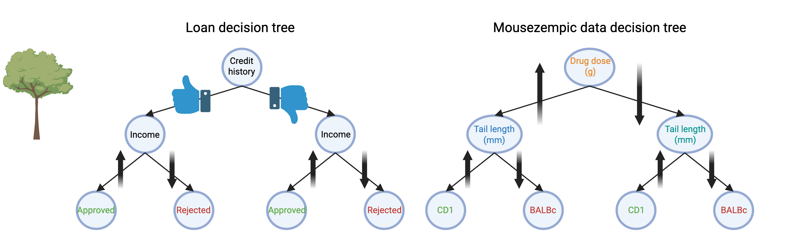
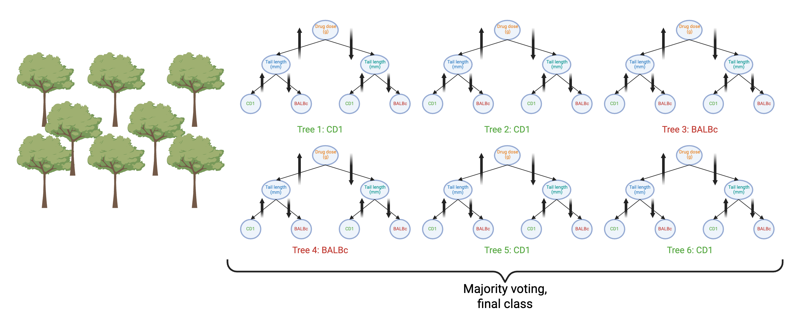

---
filters:
 - naquiz
format:
  html:
    toc: true
    toc-location: left
    toc-title: "In this session:"
---

# Workshop 8: Machine Learning {#sec-workshop08}

In this workshop, we will train, test and validate machine learning
models.

::: {.callout-tip title="Learning Objectives"}
This workshop directly builds on today's lecture. At the end of this
session, learners should be able to:

1.  Compare supervised ML domains, and explore their applications in
   biomedical research.
2.  Construct a complete `tidymodels` workflow — preprocessing
   [recipe](wk11_fr.qmd#recipe){.quarto-xref}, model specification, and
   [workflow](wk11_fr.qmd#workflow){.quarto-xref} bundle — to train a
   random forest classifier
3.  Explain the [train/test](wk11_fr.qmd#train-test-split){.quarto-xref}
   paradigm for supervised ML
4.  Explain the key metrics for assessing performance:
   [confusion matrix](wk11_fr.qmd#confusion-matrix){.quarto-xref},
   [AUROC, AUPRC](wk11_fr.qmd#auroc-auprc){.quarto-xref}
:::

To explore additional concepts discussed in the lecture beyond this
workshop, such as
[hyperparameter tuning](https://www.tidymodels.org/start/tuning/) and
[cross-validation](https://www.tidymodels.org/start/resampling/) for
improving model quality, see the `tidymodels` tutorials linked
throughout this page.

## Background {#sec-mlbackground .unnumbered}

[Machine learning](wk11_fr.qmd#machine-learning){.quarto-xref} (ML) is
an umbrella term that encompasses classical statistical methods, linear
models (both simple and generalised), and non-parametric techniques such
as decision trees, support vector machines, autoencoders, and neural
networks. Each of these methods are called machine learning
[engines](wk11_fr.qmd#engines){.quarto-xref} when used to train a
[model](wk11_fr.qmd#model){.quarto-xref}.

ML forms the foundation of
[artificial intelligence](wk11_fr.qmd#artificial-intelligence){.quarto-xref}.
For instance, large language models such as ChatGPT are trained using
deep neural networks.

Machine learning refers to the use of computers (machines) to identify
statistical trends in data and store those trends/relationships in a
model. The process of identifying trends
([learning](wk11_fr.qmd#learning){.quarto-xref}) and then predicting
features of newly provided data
([predicting](wk11_fr.qmd#predicting){.quarto-xref}) is common to all ML
workflows.

::: {.callout-note title="Does your machine need supervision?"}
ML used to predict the status (label) of new samples is termed
[supervised ML](wk11_fr.qmd#supervised-ml){.quarto-xref}.

In [unsupervised ML](wk11_fr.qmd#unsupervised-ml){.quarto-xref}, the
model is trained on data without labels. The model tries to find
patterns, groupings, or structures in the data, often by performing
pair-wise sample similarity tests. This is useful when we don't know the
categories in advance, such as clustering patients based on gene
expression profiles, or identifying hidden patterns in imaging data. We
will be learning more about this in [Tutorial 11](@sec-tute11).

Comparing 'data-driven' groupings to existing category labels can either
confirm existing categories or provide evidence for revising them.
[Principal components analysis](wk11_fr.qmd#pca){.quarto-xref},
[multidimensional scaling](wk11_fr.qmd#mds){.quarto-xref} and
[tree-based clustering](wk11_fr.qmd#tree-clustering){.quarto-xref}
algorithms are examples of unsupervised ML.
:::

## Biomedical Context {#sec-mlcontext .unnumbered}

ML has many exciting applications in biomedical research. As you saw in
the ML lecture, unsupervised and supervised ML workflows can be used on
histological (imaging) features of tissue slices, with matched labels
indicating whether the tissue is healthy/benign or malignant (cancerous)
@zhu2016. Another example of how ML can be used in this context is to
identify whether patients infected with malaria are
seropositive/seronegative based on specific anti-malaria IgG antibody
levels @longley2020.

## Terminology {#sec-mlterms .unnumbered}

In training ML models, the machine 'learns from the training dataset'
and 'predicts the validation dataset'. The accuracy of the predictions
on the validation data is used to update the model (known as
'reinforcement learning').

Once the model has been trained, it is tested on a 'hold-out' or 'test'
dataset, which has not been used at any point in training or validation.
The accuracy of performance on the test set is the ultimate test of the
'predictive value' of a model — that is, how valuable it is for
informing real-world decisions.

## Tidymodels packages {#sec-mlpackages .unnumbered}

[tidymodels](https://www.tidymodels.org/) is an R package that
encompasses multiple sub-packages, all of which work together with tidy
data! This means they seamlessly "pipe" in with our dplyr and ggplot2
functions that we've come to know very well over this course.

In the past, each ML engine was siloed in its own package, with unique
functions and arguments. `tidymodels` provides a consistent user
experience for data pre-processing, training, validation, model tuning
and prediction, and allows us to switch between ML engines quickly and
easily! Its sister package
[tidyclust](https://tidyclust.tidymodels.org/) extends the same
interface to unsupervised machine learning models — we will use it for
clustering in [Tutorial 11](@sec-tute11).

::: {.callout-note title="Further reading"}
To learn more about machine learning in R, check out the excellent book
[Tidy Modelling with R](https://www.tmwr.org)
:::

# Random Forest Classification with tidymodels {#sec-w8-supervised}

::: {.callout-tip title="Learning Objectives"}
**Aim:** Train a supervised machine learning model (classifier) to
predict mouse strain based on physiological features.

**Methods:**

1.  Explore the data
2.  Train a machine learning model using pre-defined
   [hyperparameters](wk11_fr.qmd#hyperparameter){.quarto-xref}
3.  Test the model and evaluate its performance
:::

## Setup {#sec-mlsetup}

```{r}
#| label: internal-setup
#| echo: false
#| message: false
#| warning: false 
library(tidyverse)
library(tidymodels)
library(ranger)
library(vip)
theme_set(theme_bw())
```

```{r}
#| label: setup-w8
#| output: false
#| message: false
#| eval: false 

# Install packages if not already installed
install.packages(c("tidyverse", "tidymodels", "ranger"))

# vip was recently removed from CRAN where packages live,
# so install the last CRAN version (0.4.1) from the CRAN archive
install.packages(
  "https://cran.r-project.org/src/contrib/Archive/vip/vip_0.4.1.tar.gz",
  repos = NULL,
  type = "source"
)

library(tidyverse) # Data manipulation and visualisation
library(tidymodels) # Modelling framework
library(ranger) # Random forest engine
library(vip) # Variable importance plots
```

Our `mice` dataset is clean and well-separated — almost too clean. It's
a great teaching dataset, but real-world data is rarely this tidy. To
give a more realistic sense of how ML performs on messier data, we use a
noisy version of the dataset, `noisy_dosage`, created by adding random
measurement error to the physiological features.



Save into your `data/` directory.

```{r}
noisy_dosage <- read_csv(
  "data/noisy_mousezempic_dosage_data.csv"
)
```

Or you can run the code below to download the dataset from a URL: 

```{r}
#| exec: false
#| eval: false 
noisy_dosage <- read_csv(
  "https://raw.githubusercontent.com/WEHI-Education/BIOL90042_R_Course/refs/heads/main/data/noisy_mousezempic_dosage_data.csv"
)
```

## Split Data into Training & Testing Sets {#sec-rsample}

As we are now employing a **supervised ML** algorithm, we split our
`noisy_dosage` dataset into two distinct datasets: train and test. We
train the model on the training set and evaluate it on the test set. The
test set must **never** be seen during model training or tuning — this
is what allows it to give an unbiased estimate of real-world
performance.

We use a 75/25 train/test split (`prop = 0.75`) and stratify by strain
(`strata = mouse_strain`) so that each set has proportional
representation of all three strain. To do this reproducibly and to keep 
our results consistent, we need to first set a seed. 

:::{.callout-note}
## What is a seed, and why do we set one?

Many steps in machine learning involve **randomness** — for example,
randomly assigning samples to train/test sets, or the random choices a
random forest makes while growing its trees. By default, R generates
*different* random numbers every time, so the same code can give
slightly different results each time it runs.

`set.seed()` fixes the starting point of R's random number generator.
Setting a seed means that **anyone, on any computer, in any session**,
who runs the same code will get **exactly the same results** — which is
essential for reproducible science.

Two things to know:

- The number itself is arbitrary (`123`, `2026`, anything) — what
  matters is that you pick one and don't change it.
- It is best practice to set a seed **immediately before** each step 
  that uses randomness, e.g. before `initial_split()` and before 
  `last_fit()`. If you re-run a later chunk on its own without 
  re-setting the seed, your results may differ from a full top-to-
  bottom run.
:::

```{r}
#| label: data-split-1

# set a seed
set.seed(123)

# create our 75/25 train/test split and stratify by strain
dosage_split <- initial_split(
  noisy_dosage,
  prop = 0.75,
  strata = mouse_strain
)

# subset our datasets to use in this analysis
dosage_train <- training(dosage_split)
dosage_test <- testing(dosage_split)
```

Great. Now let's confirm that our stratification was respected by
inspecting our train and test datasets for their proportion of each
strain.

```{r}
#| label: data-split-2

train_check <- dosage_train %>%
  group_by(mouse_strain) %>%
  summarise(n_strain = n()) %>%
  mutate(set = "train", proportion = n_strain / sum(n_strain))

test_check <- dosage_test %>%
  group_by(mouse_strain) %>%
  summarise(n_strain = n()) %>%
  mutate(set = "test", proportion = n_strain / sum(n_strain))

bind_rows(
  train_check,
  test_check,
)
```

Now that our data is split, we follow the standard `tidymodels`
modelling sequence: define a recipe, specify a model and engine, bundle
these into a workflow, and fit the model.

::: {.callout-note title="An alternative to a single train/test split"}
Instead of a single train/test split, we could train on the entire
dataset and estimate performance using repeated
[cross-validation](wk11_fr.qmd#cross-validation){.quarto-xref}, which
reduces the bias introduced by any one particular split. See the
tidymodels
[cross-validation tutorial](https://www.tidymodels.org/start/resampling/)
for a worked example of this approach.
:::

::::::::: {.callout-important title="Test Your Knowledge"}
:::::::: question
Why must the test set never be used during model training?

::::::: choices
::: choice
It slows down computation too much to be practical
:::

::: {.choice .correct-choice}
Using it during training would let information leak into the fitting
process, giving an overly optimistic estimate of real-world performance
:::

::: choice
The test set always contains different variables to the training set
:::

::: choice
It is only a concern for regression models, not classification
:::

:::::::
::::::::

<details>

<summary>Solutions</summary>

<p>

1.  Computation time is not the reason for the train/test split — it
   exists to give an honest estimate of performance.
2.  Correct! If the model (or its tuning process) ever sees the test
   set, performance estimates become biased ('data leakage') and no
   longer reflect how the model will perform on genuinely new data.
3.  The test set contains the same variables as the training set — only
   the *observations* differ.
4.  The train/test paradigm applies equally to regression and
   classification tasks.

</p>

</details>
:::::::::

## Define a Preprocessing Recipe {#sec-recipe}

The **[recipe](wk11_fr.qmd#recipe){.quarto-xref}** specifies which
variables (columns) we want to include in our model and what
preprocessing steps should be applied to them, expressed as a
statistical formula: `outcome variable ~ predictor variables`.

```{r}
#| label: recipe-example
#| eval: false 
#| exec: false 
recipe(
  # your recipe in outcome variable ~ predictor variables (all)
  mouse_strain ~ .,
  # remember: we create our model on the training dataset only
  data = dosage_train
)
```

As this is a **supervised ML** workflow, we specify `mouse_strain` as
the outcome variable in the recipe formula, and keep all remaining
columns as predictor variables by using `.` on the right-hand side.

We can add pre-processing steps using the `step_*` functions in the 
`recipes` R package. Examples of pre-processing functions include: 

- `step_corr()` can remove correlated predictors from your recipe so
  that redundant variables carrying the same information are dropped.
  Highly correlated predictors can inflate model variance and make
  feature importance estimates unstable.
-  `step_dummy()` converts categorical predictors (`sex`, `cage_number`) 
  into one-hot encoded numeric columns, since most ML engines require 
  numeric inputs. 
- `step_log()` converts numeric values to their logarithm, which can 
  help reduce the impact of large values in the data. 
-  `step_normalize()` can scale numeric predictors to mean = 0, sd = 1. 
  This ensures that a variable with a large numeric range does not
  dominate a variable with a small range simply because of its scale. 
- `step_sqrt()` applies a square-root transformation to numeric
  predictors, which compresses large values to reduce right-skewness
  and the influence of extreme observations.
- `step_naomit()`, `step_mutate()`, `step_filter()` and other
  dplyr-style verbs let you tidy your data inside the recipe (e.g.
  dropping rows with missing values or creating new columns) so that
  the same transformations are applied consistently to both the
  training and test sets, preventing data leakage.

Note that: 
- `all_nominal_predictors()` can be used inside e.g. `step_dummy()`
  to apply that step to all nominal (or categorical) predictor variables
  in the recipe. 
- `all_numeric_predictors()` can be used inside e.g. `step_log()`, 
  `step_normalise()`, `step_sqrt()` to apply that step to all 
  numeric predictor variables in the recipe. 

For our dataset, we will add two preprocessing steps:

```{r}
#| label: rf-recipe

dosage_recipe <- recipe(mouse_strain ~ ., data = dosage_train) %>%
  # we will use step_normalize():
  # put all numeric predictors on a comparable scale (mean 0,
  # sd 1) so differences in units — e.g. drug dose vs weight
  # lost — don't bias the model
  step_normalize(all_numeric_predictors()) %>%
  # we will use step_dummy():
  # convert categorical predictors (e.g. sex, cage_number) into
  # numeric columns, since most ML engines only accept numeric inputs
  step_dummy(all_nominal_predictors())

summary(dosage_recipe)
```

::: {.callout-tip title="Curious about redundant predictors?"}
We use **all** four physiological features here without checking whether any
are redundant. See the tidymodels
[Feature Engineering and Selection](https://www.tidymodels.org/books/fes/)
book for a discussion of checking for correlated predictors and reducing
dimensionality.
:::

## Specify the Random Forest Model {#sec-parsnip-model}

A random forest is built from many individual **decision trees**. A
single decision tree makes a prediction by asking a series of yes/no
questions about the predictors, splitting the data at each step until it
reaches a decision. For example, a bank might decide whether to approve
a loan by first checking an applicant's credit history, then their
income (@fig-decision-tree, left). The same logic applies in a
biological context: a tree could classify a sample as disease-positive
or -negative based on the expression levels of a few genes
(@fig-decision-tree, right).

{#fig-decision-tree}

::: {.callout-tip title="What is a Random Forest?"}
A single decision tree can easily overfit its training data. A
[random forest](wk11_fr.qmd#random-forest){.quarto-xref} addresses this
by growing an **ensemble** of many decision trees, each on a random
bootstrap sample of the data, considering only a random subset of
predictors at each split (`mtry`). This makes the trees independent and
uncorrelated with one another. Every tree "votes" on the predicted
class, and the forest's final prediction is simply the **majority vote**
across all trees (@fig-random-forest), typically giving more accurate
and stable predictions than any single tree.
:::

{#fig-random-forest}

Below we specify the random forest model. We use the default
hyperparameters for `mtry` and `min_n`, and fix the number of trees at
500 (`trees = 500`). If you'd like to see how to systematically search
for better hyperparameter values, see the tidymodels
[hyperparameter tuning tutorial](https://www.tidymodels.org/start/tuning/).

For the engine, we use the
[`ranger`](https://cran.r-project.org/package=ranger) R package, and set
`importance = "impurity"` so that we can later calculate variable
importance, which is a measure of how much each predictor contributes to
classification accuracy.

```{r}
#| label: rf-spec

rf_model <- rand_forest(trees = 500) %>%
  set_engine("ranger", importance = "impurity") %>%
  set_mode("classification")

rf_model
```

## Bundle into a Workflow {#sec-workflows}

We now combine the recipe and model into a single
**[workflow](wk11_fr.qmd#workflow){.quarto-xref}** object. Bundling them
together ensures that the same preprocessing steps are always applied
consistently whenever the model is fitted or used to predict — reducing
the risk of errors and making the pipeline reproducible.

```{r}
#| label: rf-workflow

# Combine the recipe and model into a workflow
rf_workflow <- workflow() %>%
  add_recipe(dosage_recipe) %>%
  add_model(rf_model)

rf_workflow
```

## Fit the Model {#sec-parsnip-fit}

We now fit the final model on the full training set and evaluate it on
the test set.

The `last_fit()` function fits the workflow once on the training data
and generates predictions on the held-out test set in a single step.
Recall that the test set has not been seen during training or tuning.

```{r}
#| label: finalise-rf

# Set a new seed
set.seed(456)

# Fit model on the training data and generate predictions on test data
final_fit <- last_fit(rf_workflow, dosage_split)

# Visualise the results of model fitting
final_fit
```

The output of `final_fit` doesn't actually tell us much. It says that we
have successfully fitted a random forest model to the training data, and
that predictions were generated on the test set, but it gives no
indication of how well the model actually performed. All we have at this
point is confirmation that the workflow ran end-to-end: the resampling
split was applied, the recipe was prepped, the model was trained on the
249 training mice, and predictions were made for the 84 held-out test
mice.

To judge whether our model is any good, we need to interrogate this
fitted object further. The next step is to explicitly collect the
performance metrics stored inside `final_fit` and evaluate the model's
predictions against the true test set labels.

## Evaluate Model Performance {#sec-tune-yardstick}

We can collect the test set performance metrics using
`collect_metrics()`. By default this reports `accuracy` (the proportion
of correctly classified mice), `roc_auc` (AUROC, the Area Under the
Receiver Operating Characteristic Curve) and `brier_class` (the Brier
score is the mean squared error between predicted class probabilities
and true outcomes, lower values indicate better calibrated probability
predictions). 

```{r}
#| label: model-metrics

collect_metrics(final_fit)
```

::: {.callout-important title="Practice exercise: Increasing number of trees in our forest"}
What would happen if we increased the number of trees in our random 
forest? Create a random forest model now with `trees = 5000`, using 
the `ranger` engine and `"classification"` mode. Save this into a new 
model object and collect the metrics using `collect_metrics()`. Compare
this with `final_fit`. 

<details>

<summary>Solution</summary>

```{r}
#| label: compare-with-more-trees 
# Create our new model with 5,000 trees
rf_trees_model <- rand_forest(trees = 5000) %>%
  set_engine("ranger", importance = "impurity") %>%
  set_mode("classification")

# Bundle into a workflow
rf_trees_workflow <- workflow() %>%
  add_recipe(dosage_recipe) %>%
  add_model(rf_trees_model)

# Fit the workflow to the training data (using same seed)
rf_trees_fit <- last_fit(rf_trees_workflow, dosage_split)

# Evaluate model performance of new model
collect_metrics(rf_trees_fit)
```

In this case, `accuracy` is almost the same as the previous model. The
`roc_auc` improved from 0.969 (`final_fit`) to 0.971 (`rf_trees_fit`). 
The brier class was lower in `rf_trees_fit` compared to `final_fit`, 
indicating better probability predictions. This is expected: as we
increase the number of trees in a random forest, predictions are
averaged over more trees, reducing variance and giving slightly more
stable and accurate probability estimates. However, the gains are
typically small beyond a few hundred trees, and training time
increases accordingly.

</details>
:::

We can also visualise performance using precision-recall (PR) and ROC
curves. Since `mouse_strain` has three classes, `pr_curve()` and
`roc_curve()` use a **one-vs-all** strategy, treating each strain in
turn as the positive class against the other two.

:::{.callout-note title="What do the Precision-Recall and Receiver Operating Characteristic Curves show us?"}


PR curves (Left) show the trade-off between **precision** (y-axis; e.g.,
out of all the mice classified as CD1, how many were actually CD1?) and
**recall** or sensitivity (x-axis; e.g., out of all the real CD1 mice in
the dataset, how many did the model successfully classify?) as the
classification threshold varies.

ROC curves (Right) plot the **true positive rate** or sensitivity
(y-axis; e.g., out of all the real CD1 mice in the dataset, how many did
the model successfully classify?) against the **false positive rate** or
1 - specificity (x-axis; e.g., out of all the non-CD1 mice in the
dataset, how many did the model wrongly mistake for CD1?) as the
classification threshold varies. A curve that bows toward the top-left
corner indicates better discrimination between classes, and an AUC
closer to 1.0 indicates better overall classification performance.
:::

### Precision-Recall Curve {#sec-prc}

```{r}
#| label: aupr-curve

final_fit %>%
  collect_predictions() %>%
  pr_curve(
    truth = mouse_strain,
    .pred_BALBc,
    .pred_Black6,
    .pred_CD1
  ) %>%
  autoplot() +
  labs(title = "PR Curves: Random Forest (Test Set)")
```

In this graph, we can see that the model maintains high precision even
as recall increases, meaning it identifies most positive cases while
keeping the number of false positives low. A curve that stays near the
top-right corner indicates strong performance; the baseline for a
"no-skill" classifier is the prevalence of the positive class, not 0.5
as with AUROC.

::: {.callout-important title="Practice exercise: Increasing number of trees in our forest: PR Curves"}

Using the `rf_trees_fit` fitted model with 5,000 trees instead of 500 
trees in `final_fit`, now evaluate the PR curve. How does this impact 
the PR curve? 

<details>

<summary>Solution</summary>

```{r}
#| label: compare-with-more-trees-2
rf_trees_fit %>%
  collect_predictions() %>%
  pr_curve(
    truth = mouse_strain,
    .pred_BALBc,
    .pred_Black6,
    .pred_CD1
  ) %>%
  autoplot()
```

The PR curve is nearly identical to the one generated from `final_fit`
with 500 trees. Increasing the number of trees from 500 to 5,000 does
not meaningfully change the precision-recall trade-off: both curves hug
the top-right corner, maintaining high precision across the full range
of recall for all three strains. This is consistent with the metrics we
compared earlier: once a random forest has enough trees for predictions 
to stabilise, adding more trees yields only marginal improvements, since
predictions are already averaged over a large ensemble. The main cost of 
the extra trees is computation time, not model performance.

</details>

:::

We can also calculate the Area under the PR Curve (AUPRC) using the
`final_fit` object. The AUPRC value represents the area under the PR
curve and provides a single value to summarize the model's performance
across all classification thresholds.

```{r}
#| label: aupr-calculate 
# Calculate AUPRC (one-vs-all per strain class)
final_fit %>%
  collect_predictions() %>%
  pr_auc(
    truth = mouse_strain,
    .pred_BALBc,
    .pred_Black6,
    .pred_CD1
  )
```

An AUPRC of 0.927 indicates the model maintains high precision across
most recall levels for each strain — strong positive-class performance.

::::::::: {.callout-important title="Test Your Knowledge"}
:::::::: question
Looking at the PR curves and AUPRC for each mouse strain in `final_fit`, 
which class does the model predict best?

::::::: choices
::: {.choice .correct-choice}
Black6 is predicted best (its curve stays closest to the top-right
corner)
:::

::: choice
BALBc is predicted best because its curve has the highest baseline
:::

::: choice
All three strains are predicted equally well, since they come from the
same random forest model
:::

::: choice
CD1 is predicted best because it has the highest prevalence in the test
set
:::

:::::::
::::::::

<details>

<summary>Solutions</summary>

<p>

1.  Correct! Black6's PR curve stays nearest the top-right corner (AUPR
   ≈ 0.999), indicating the model identifies Black6 mice with both high
   precision and high recall. BALBc is the least prevalent class
   (~20% of the test set), and with fewer positive cases its precision
   estimates are noisier and the curve less stable.
2.  Incorrect — BALBc actually has the *lowest* AUPR (~0.84) of the
   three strains, and a low prevalence lowers, not raises, the baseline
   of a PR curve.
3.  Incorrect — a single model can perform very differently across
   classes, especially when class frequencies are imbalanced.
4.  Incorrect — while CD1 is the most prevalent class, its curve sits
   below Black6's; prevalence alone does not determine predictive
   performance.

</p>

</details>
:::::::::

### Receiver Operating Characteristic Curve {#sec-roc}

```{r}
#| label: auroc-curve

final_fit %>%
  collect_predictions() %>%
  roc_curve(
    truth = mouse_strain,
    .pred_BALBc,
    .pred_Black6,
    .pred_CD1
  ) %>%
  autoplot() +
  labs(title = "ROC Curves: Random Forest (Test Set)")
```

Because `mouse_strain` has three classes, this produces one curve per
strain (each treating that strain vs. the other two) rather than a
single combined curve. Here we can see that our ROC curves are all
within the top left-hand corner, so that's great.

::: {.callout-important title="Practice exercise: Increasing number of trees in our forest: ROC Curves"}

Using the `rf_trees_fit` fitted model with 5,000 trees instead of 500 
trees in `final_fit`, now evaluate the ROC curve. How does this impact 
the ROC curve? 

<details>

<summary>Solution</summary>

```{r}
#| label: compare-with-more-trees-3
rf_trees_fit %>%
  collect_predictions() %>%
  roc_curve(
    truth = mouse_strain,
    .pred_BALBc,
    .pred_Black6,
    .pred_CD1
  ) %>%
  autoplot()
```

The ROC curve is nearly identical to the one generated from `final_fit`
with 500 trees. Increasing the number of trees from 500 to 5,000 does
not meaningfully change the sensitivity-specificity trade-off: both
curves hug the top-left corner, maintaining high sensitivity across
almost the full range of specificity for all three strains. This is
consistent with the metrics we compared earlier (`roc_auc` of 0.969
vs 0.971). 

</details>

:::

As with the PR curve and AUPCR, we can calculate the AUROC for our ROC
curve.

```{r}
# Calculate AUROC for our ROC curve
final_fit %>%
  collect_predictions() %>%
  roc_auc(
    truth = mouse_strain,
    .pred_BALBc,
    .pred_Black6,
    .pred_CD1
  )
```

The AUC for this model is 0.971 which is a very strong indicator of
model classification performance.

::::::::: {.callout-important title="Test Your Knowledge"}
:::::::: question
Looking at the ROC curves and AUROC for each mouse strain in
`final_fit`, which class does the model predict best?

::::::: choices
::: choice
BALBc is predicted best because it is the least prevalent class
:::

::: choice
All three strains are predicted equally well, since they come from the
same random forest model
:::

::: {.choice .correct-choice}
Black6 is predicted best (its curve stays closest to the top-left
corner)
:::

::: choice
CD1 is predicted best because it has the highest prevalence in the test
set
:::

:::::::
::::::::

<details>

<summary>Solutions</summary>

<p>

1.  Incorrect — BALBc actually has the *lowest* AUROC (~0.96, roughly
   tied with CD1). Unlike a PR curve, the ROC curve's no-skill baseline
   is the diagonal line regardless of prevalence, and low prevalence
   does not make performance better.
2.  Incorrect — a single model can perform very differently across
   classes, especially when class frequencies are imbalanced.
3.  Correct! Black6's ROC curve stays nearest the top-left corner
   (AUROC ≈ 0.999), indicating the model identifies Black6 mice with
   both high sensitivity and high specificity across almost all
   classification thresholds.
4.  Incorrect — while CD1 is the most prevalent class, its curve sits
   below Black6's (AUROC ≈ 0.96 vs 0.999); prevalence alone does not
   determine predictive performance.

</p>

</details>
:::::::::

### Confusion Matrix {#sec-confmat}

We can also evaluate the confusion matrix (`conf_mat()`), where rows are
our "truth" (the strain in `noisy_dosage`; `truth = mouse_strain`) and
columns are the "predictions" (the predicted strain;
`estimate = .pred_class`). Diagonal cells are correct predictions, while
off-diagonal cells are misclassifications.

```{r}
#| label: confusion-matrix

final_fit %>%
  collect_predictions() %>%
  conf_mat(
    truth = mouse_strain,
    estimate = .pred_class
  ) %>%
  autoplot(type = "heatmap") +
  labs(title = "Confusion Matrix: Random Forest (Test Set)")
```

::: {.callout-important title="Practice exercise: Increasing number of trees in our forest: Confusion Matrix"}

Using the `rf_trees_fit` fitted model with 5,000 trees instead of 500 
trees in `final_fit`, now evaluate the confusion matrix. How does this 
impact the confusion matrix results? 

<details>

<summary>Solution</summary>

```{r}
#| label: compare-with-more-trees-4
rf_trees_fit %>%
  collect_predictions() %>%
  conf_mat(
    truth = mouse_strain,
    estimate = .pred_class
  ) %>%
  autoplot(type = "heatmap")
```

The confusion matrix is essentially unchanged: with 5,000 trees we see
the same pattern of (mostly diagonal) correct predictions and the same
small number of misclassifications as with 500 trees. Both models
correctly identify all 29 Black6 mice, while the few errors remain
concentrated between BALBc and CD1 — the two strains whose predicted
probabilities overlapped most in our earlier plots.

This illustrates an important property of random forests: performance
generally does not keep improving as we add more trees. Each tree in
the forest is built slightly differently, and once we have enough
trees, averaging their predictions together gives a stable result —
extra trees just average into more of the same rather than adding new
information. Increasing `trees` from 500 to 5,000
therefore has little effect on the confusion matrix (here the overall
accuracy is identical, with AUROC increasing only marginally from
~0.969 to ~0.971), while costing roughly 10x the computation time.
Random forests also do not overfit as more trees are added, so in
practice we choose a number of trees that is "large enough" for the
predictions to stabilise, rather than tuning it like other
hyperparameters.

</details>

:::

::: {.callout-note title="Try it yourself"}
Using `collect_predictions(final_fit)`, compute the sensitivity,
specificity, positive predictive value (PPV) and negative predictive
value (NPV) for each strain class (see the `yardstick` package
functions: `sens()`, `spec()`, `ppv()`, `npv()`). The tidymodels
[cross-validation tutorial](https://www.tidymodels.org/start/resampling/)
works through a similar calculation in detail if you'd like a worked
example.

<details>

<summary>Solution</summary>

```{r}
#| label: sens-spec-ppv-npv
preds <- final_fit %>%
  collect_predictions()

# Sensitivity (recall): proportion of actual positives correctly identified
sens(preds, truth = mouse_strain, estimate = .pred_class)

# Specificity: proportion of actual negatives correctly identified
spec(preds, truth = mouse_strain, estimate = .pred_class)

# Positive predictive value (precision): proportion of positive predictions that are correct
ppv(preds, truth = mouse_strain, estimate = .pred_class)

# Negative predictive value: proportion of negative predictions that are correct
npv(preds, truth = mouse_strain, estimate = .pred_class)
```

With more than two classes, these functions compute each metric using a
"one-vs-rest" approach for every class and then return the
macro-averaged result (the default `estimator = "macro"`). You can also
compute all four metrics at once with `metric_set()`:

```{r}
#| label: all-class-metrics
class_metrics <- metric_set(sens, spec, ppv, npv)

class_metrics(
  preds,
  truth = mouse_strain,
  estimate = .pred_class
)
```

Here, all four metrics are very high, consistent with the
nearly-diagonal confusion matrix we saw earlier.

</details>
:::

::::::::: {.callout-important title="Test Your Knowledge"}
:::::::: question
A classifier has an AUROC of 0.90 but an AUPRC of only 0.30. What does
this most likely indicate?

::::::: choices
::: choice
The model is performing extremely well overall, with no concerns
:::

::: {.choice .correct-choice}
The classes in the dataset are likely imbalanced — AUPRC is more
sensitive to class imbalance than AUROC
:::

::: choice
AUPRC and AUROC should always be equal, so this must be a coding error
:::

::: choice
The confusion matrix is no longer needed once you have an AUROC value
:::

:::::::
::::::::

<details>

<summary>Solutions</summary>

<p>

1.  A high AUROC alongside a low AUPRC is a red flag, not a sign of
   strong performance — it usually means the model looks good on paper
   but struggles with the minority class.
2.  Correct! As shown in the lecture's imbalanced-data example, AUROC
   can remain high under class imbalance while AUPRC drops sharply,
   because AUPRC is sensitive to how rare the positive class is.
3.  These two metrics measure different trade-offs
   (sensitivity/specificity vs precision/recall) and are not expected to
   match.
4.  The confusion matrix, AUROC and AUPRC each reveal different aspects
   of performance and are best used together.

</p>

</details>
:::::::::

## Variable Importance Plot {#sec-var}

You may be interested in understanding which predictor variable was the
most important in informing the final classification prediction. We can
do this by extracting the fitted model (`extract_fit_parsnip()`) and
plotting variable importance using the `vip` R package.

Importance is measured by mean decrease in node impurity (Gini
impurity), where higher values indicate a greater contribution to
classification decisions. This tells us which physiological features
best distinguish strains.

```{r}
#| label: variable-importance

final_fit %>%
  extract_fit_parsnip() %>%
  vip() +
  labs(title = "Variable Importance: Random Forest")
```

Here we can see that `initial_weight_g` is the most important variable
that informs our random forest, and `sex` as the least informative
variable!

## Predict Strain for the Synthetic Unlabelled Dataset {#sec-apply-models}

Now that we have a trained and evaluated model, we can use it to predict
on genuinely new data — this is often the ultimate goal of training an
ML model.

First, let's save our trained model so that we can apply it to this new
unseen dataset. 

```{r}
#| label: save-model
#| eval: false 
#| exec: false
saveRDS(final_fit, "model/dosage.rds")
```

Now, let's load in our new, unlabelled dataset, `new_dosage`, containing 
physiological measurements but **no strain labels**.



Save into your `data/` directory.

```{r}
#| label: predict-new-data

new_dosage <- read_csv("data/new_mousezempic_dosage_data.csv") %>%
  # Convert character columns to factors to match the training data's
  # column types: step_dummy() in the recipe expects factor predictors
  mutate(across(where(is.character), as.factor))
```

Or you can run the code below to download the dataset from a URL: 

```{r}
#| exec: false
#| eval: false 
new_dosage <- read_csv(
  "https://raw.githubusercontent.com/WEHI-Education/BIOL90042_R_Course/refs/heads/main/data/new_mousezempic_dosage_data.csv"
) %>%
  # Convert character columns to factors to match the training data's
  # column types: step_dummy() in the recipe expects factor predictors
  mutate(across(where(is.character), as.factor))
```


Because we created this model in our working R session, we can use the 
`extract_workflow()` function on the `final_fit` object to simply extract 
the workflow and apply it to the dataset: 

```{r}
#| label: predict-new-data-extract 
# Extract the final fitted model from last_fit()
final_model <- extract_workflow(final_fit)
```

But it is often the case where we are applying the model in new R 
sessions or we give this to a collaborator for them to use. In this case, 
we will use our `model/dosage.rds` file that we saved and then the 
`extract_workflow()` function: 

```{r}
#| label: predict-new-data-rds
#| eval: false
#| exec: false 
loaded_model <- readRDS("model/dosage.rds")
final_model <- extract_workflow(loaded_model)
```

Now let's apply the model to our new dataset `new_dosage`. 

```{r}
# Generate class predictions and class probabilities
new_predictions <- new_dosage %>%
  bind_cols(
    # generate class predictions
    predict(final_model, new_data = new_dosage),
    # generate class probabilities
    predict(final_model, new_data = new_dosage, type = "prob")
  )

# View predictions with confidence probabilities
head(new_predictions, 10)
```

::: {.callout-note title="Functions: Convenience is key!"}

It's often useful to wrap this prediction logic into a **reusable
function**, so you (or a collaborator) can apply the saved model to any
new dataset without repeating the code above.

```{r}
#| label: predict-mice-function

# Save the fitted model so it can be reloaded without re-training

predict_mice <- function(df, model = "model/dosage.rds") {
  # Match the column types used during training
  df <- df %>% mutate(across(where(is.character), as.factor))

  # Load the saved model
  final_fit <- readRDS(model)

  # Extract the fitted workflow from last_fit()
  final_model <- extract_workflow(final_fit)

  # Generate class predictions and class probabilities
  df %>%
    bind_cols(
      predict(final_model, new_data = df),
      predict(final_model, new_data = df, type = "prob")
    )
}

predict_mice(new_dosage)
```

::: 

# Summary {#sec-w8-summary}

Today we've learned the fundamental principles of machine learning in R, 
specifically using the `tidymodels` R packages to develop a **supervised**
machine learning **classification** model. Here is a quick summary of
what we've learnt: 

- The difference between **supervised** and **unsupervised** machine
  learning, and where **classification** fits in
- The `tidymodels` ecosystem for building machine learning models in R
- Splitting data into **training** and **testing** sets with `rsample`,
  using `set.seed()` for reproducibility and **stratified** sampling to
  preserve class balance
- Defining preprocessing steps in a **recipe** (`recipes`) so the same
  transformations are applied consistently to training and test data
- Specifying a **random forest** classification model with `parsnip`
  and bundling it with the recipe into a **workflow** (`workflows`)
- Fitting the model on the training data with `last_fit()` and
  evaluating its performance on held-out test data
- Assessing classification performance using **accuracy**, **precision–
  recall curves (AUPRC)**, **ROC curves (AUROC)**, **confusion
  matrices**, and per-class metrics like **sensitivity**, **specificity**,
  **PPV** and **NPV** (`yardstick`)
- Using **variable importance plots** (`vip`) to identify which
  predictors drive the model's decisions
- Saving a fitted model (`saveRDS()`), reloading it, and applying it to
  **predict classes and class probabilities** on new, unlabelled data —
  including wrapping the prediction logic in a reusable function

You can download the summary sheet from this workshop here:



In Tutorial 11, you will apply the same recipe–model–workflow concepts to 
**unsupervised** machine learning, using k-means clustering to discover 
groupings in **unlabelled** data.

If you'd like to learn more, look at the [further reading](wk11_fr.qmd) 
for this week, which includes links to `tidymodels` resources that can help
for steps **not** covered in this workshop such as hyperparameter tuning and 
cross-validation.

